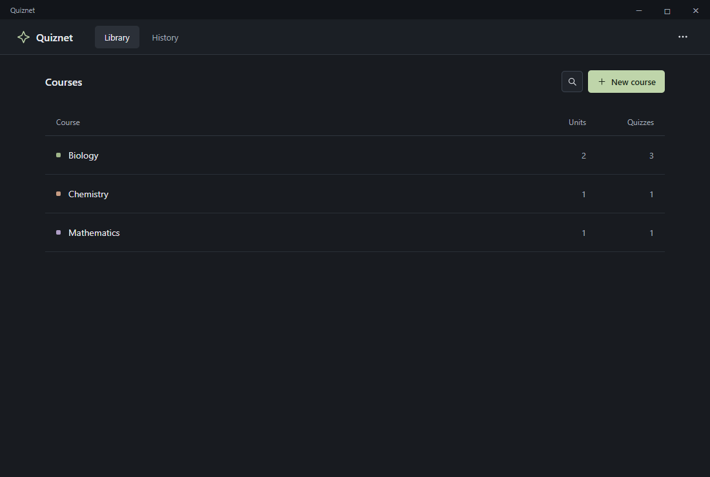

# Quiznet

A local Windows app for organizing **Courses → Units → Quizzes** and testing yourself with single-answer, multiple-answer, and true/false questions. The interface uses a dark theme, compact lists, and menus for secondary actions.

Quiznet runs offline and stores your material on your computer. The repository is currently private; its contributor and maintenance guides prepare it for future development and eventual public release.

The current release is **Quiznet Alpha 2**. Releases progress through **Alpha → Beta → Official Release**, with stage changes only when the owner approves them. **Plugins** and **Explore** (discovering tests shared by others) are the two major Alpha goals; both are planned. Beta will focus on wider testing, feedback, and fixes before the first Official Release. See the [release plan](docs/RELEASES.md) and [roadmap](docs/ROADMAP.md).

The Focus identity uses a geometric Q, forest green, and sage on charcoal. See the [brand guide](docs/BRAND.md) for editable artwork, colors, and the icon export command.



## Use it

Download the `Quiznet-Windows` artifact from a successful [Windows app build](https://github.com/iSariiSA/quiznest/actions/workflows/build.yml), extract it, and find `Quiznet-Setup.exe`. GitHub sign-in and repository read access are required for artifact downloads. [Download instructions](https://docs.github.com/en/actions/how-tos/manage-workflow-runs/download-workflow-artifacts).

Run `Quiznet-Setup.exe` once, then open **Quiznet** from your Desktop or Start menu. It installs for your Windows account without administrator access. No account, browser, server, Node.js, or internet connection is required to use the app. The build supports Windows 10/11 on x64 computers. This personal-use build is unsigned.

For updates, run the new `Quiznet-Setup.exe`. It replaces the existing installation and keeps the same shortcut, courses, questions, history, and saved quiz progress. Versions 1.0 and 1.1 already use the same data folder; no migration is needed. Opening Quiznet again focuses the existing window.

Start with the included Biology, Chemistry, and Mathematics sample courses, or create your own. You can edit or delete the samples.

- Create, rename, and delete courses and units.
- Create and edit mixed quizzes: single answer, multiple answers, and true/false, with optional explanations.
- Add or remove choices as needed (2–100 for choice questions); edit true/false labels in your language.
- Add local images and use HTML formatting in questions, options, and explanations.
- Display syntax-highlighted code, including Python, and use Markdown with fenced code blocks.
- Use the top-right **…** menu to import JSON/CSV, open Settings, or view Help.
- Preview imports and choose a destination course/unit.
- Take quizzes with optional question shuffling, question navigation, and keyboard shortcuts.
- Leave a quiz and resume it later, including after closing the app.
- See your score, correct answers, explanations, and practice history.
- Export individual quizzes, back up the whole library, and restore a backup.

## Local storage

Your library lives in `%APPDATA%\Quiznet\data\library.json`. **… → Settings → Open folder** shows its exact location.

Changes are serialized and saved using a flushed temporary file and atomic replacement. `library.json.bak` holds the previous successful state. If the main file is damaged, Quiznet recovers the previous state when possible and keeps the damaged file. If neither file is valid, Quiznet preserves both and reports the problem instead of silently resetting your library.

Restoring a backup also saves `before-restore-<timestamp>.json` in the data folder. These files may contain your study material; copy or manage them as you would any personal document.

To move to another computer, install Quiznet there and use **Save backup** and **Restore** in Settings. Updating or uninstalling the app keeps the data folder.

## Import questions

### JSON

```json
{
  "course": "Biology",
  "unit": "Unit 1: Cells",
  "title": "Quiz 1",
  "questions": [
    {
      "prompt": "Which organelle contains most of a cell's DNA?",
      "options": ["Nucleus", "Ribosome", "Golgi apparatus", "Lysosome"],
      "correctAnswer": 0,
      "explanation": "Most DNA in a eukaryotic cell is stored in the nucleus."
    }
  ]
}
```

`correctAnswer` is a **zero-based number**: 0 is the first answer, 1 the second, and so on. An option letter (`A`, …, `Z`, `AA`, …) or exact option text is also accepted. Explanations are optional. Omitted `type` means `single-choice`, preserving existing quizzes.

Set `"type": "multiple-answer"` and use `"correctAnswers": [0, 2]` for a question with several correct choices. The array must contain at least one distinct valid option; letters or exact option texts also work. During practice, click again to deselect a choice. Scoring requires the complete correct set without extra choices; there is no partial credit. At least one selection is required to finish.

Set `"type": "true-false"` with two `options` and one `correctAnswer` for true/false questions. The two labels are editable content, so you can use other languages. All types support images and HTML. Mix types in any quiz; see [mixed-questions.json](examples/mixed-questions.json).

Aliases: `question` for `prompt`, `choices` for `options`, and `answer` or `correctIndex` for `correctAnswer` (`answer` may be an array for multiple-answer questions). Arrays of `{ "text": "…", "isCorrect": true/false }` options are accepted with one marked correct for single answers, or one or more for multiple answers. A bare questions array is accepted. To import several quizzes, use `{ "quizzes": [<quiz>, <quiz>] }`.

Missing course/unit names default to `Imported course` and `Unit 1`. The preview lets you override the destination. Matching course/unit names reuse the existing items; duplicate quiz titles receive a numeric suffix so existing quizzes are preserved.

### Images and HTML

In the quiz editor, choose **Add image** for a local PNG, JPEG, GIF, or WebP file (up to 2 MB). An optional image description helps accessibility. **Replace image** and the image's remove button update that attachment. Open **Preview** to check the question before saving.

Choose **HTML** in the **Format** selector to format the prompt, options, and explanation. Supported formatting includes paragraphs, bold/italic text, lists, tables, code, and superscripts/subscripts. Images may also appear inside HTML using embedded raster data URLs. Scripts, styles, forms, embedded pages, event handlers, and external links or image sources are removed from the displayed content. Existing questions retain their format.

For JSON imports, set `"format": "html"`. Attach an image with `"image": "data:image/png;base64,..."` and optional `"imageAlt": "Description"`. The image field must contain the complete base64 data URL, not a filename or an online URL. The editor creates that value for you; export a quiz to reuse it. See the complete [images and HTML example](examples/images-html.json).

```json
{
  "format": "html",
  "prompt": "<p>Which formula represents <strong>water</strong>?</p>",
  "options": ["H<sub>2</sub>O", "CO<sub>2</sub>"],
  "correctAnswer": 0,
  "explanation": "Two hydrogen atoms and one oxygen atom."
}
```

Images are embedded in the local library, exports, backups, and historical attempts. The original image file is no longer needed after saving. Keep images small for faster saves and smaller backups. Version 1.3 reads existing version-1 libraries without a migration; earlier apps do not preserve these new optional fields, so use 1.3 or newer for image/HTML libraries.

### CSV

```csv
course,unit,title,question,option_a,option_b,answer,explanation
Biology,Unit 1: Cells,Quiz 1,Where is most DNA stored?,Nucleus,Ribosome,A,Inside the nucleus.
```

Use consecutive `option_a`, `option_b`, …, `option_z`, `option_aa`, … columns for 2–100 choices. Trailing empty option cells are ignored so rows can have different choice counts. CSV answers are letters or exact option text. Course, unit, title, and explanation are optional columns. Quotes support commas, escaped double quotes, and multiline text. Rows are grouped by course/unit/title.

The optional `type` column accepts `single-choice`, `multiple-answer`, and `true-false`. For multiple answers, the `answer` cell is a JSON array, quoted as CSV requires, such as `"[0,2]"` or `"[""A"",""C""]"`. True/false rows need two nonempty option cells and one answer. Missing type uses single answer.

Optional `format`, `image`, and `image_alt` columns support the same HTML mode and embedded images. Quote data URLs because they contain a comma, and escape double quotes in HTML as CSV requires.

Quiz import files are limited to 20 MB, 1,000 quizzes, and 10,000 questions per import. The editor limits each quiz to 19 MB to keep exports importable. Validation is all-or-nothing. Examples are in [examples/](examples/). Full library backups are restored from Settings rather than imported as questions; the quiz-import file limit does not apply to backups.

### Code and Markdown

In the editor, choose **Add code**, select a **Code language**, and paste the snippet. Code is displayed with syntax colors, preserved indentation, and horizontal scrolling; it is never executed. Code attachments work with plain-text, HTML, and Markdown questions and can accompany images.

Choose **Markdown** in the **Format** selector for headings, emphasis, lists, tables, inline code, and fenced code blocks in prompts, answer options, and explanations. Start a fenced block with three backticks followed by its language (for example, `python`), put the code on the following lines, and close it with three backticks. The same selector offers Text and HTML; existing questions retain their format.

The language catalog includes Python, JavaScript, TypeScript, Java, C, C++, C#, SQL, JSON, HTML/XML, CSS, Bash, Markdown, and plain text. Unknown language names render as plain text. All libraries and language definitions are bundled with the app for offline use. Raw HTML in Markdown is shown literally; external links and images remain inactive.

For JSON imports, add `"code": "print(1 + 2)"` and `"codeLanguage": "python"`, or set `"format": "markdown"` and include fenced blocks. CSV has optional `code` and `code_language` columns; quote multiline snippets. See [code-markdown.json](examples/code-markdown.json) for a complete mixed example. Code and Markdown survive exports, backups, saved attempts, and results.

Code attachments are limited to 50,000 characters and Markdown fields to 100,000. Blocks above 12,000 characters display as plain code to keep the interface responsive. Version 1.5 reads earlier libraries without rewriting them on startup; older apps do not preserve code fields or understand Markdown, so keep a backup before rollback.

## Keyboard shortcuts

| Shortcut | Action |
| --- | --- |
| Ctrl + K | Search courses, quizzes, units, and question text |
| 1–9 | Select or toggle the corresponding answer while taking a quiz |
| Tab, Shift + Tab, Space / Enter | Reach and select any choice, including beyond the first nine |
| Left / right arrows | Move between questions |
| Escape | Close a dialog |

## Develop

Node.js 22.12+ and npm are needed for development only. Dependency installation downloads the Electron runtime and packaging tools; the finished app runs offline.

```sh
npm ci
npm start
npm run check
npm test
npm run test:app
npm audit --audit-level=high
npm run build
```

The offline Windows installer appears as `dist/Quiznet-Setup.exe`. Keep the app ID, product name, install identity, and data folder stable so future releases update the same application. Internal version numbers change; the installer and shortcut names stay the same. See [AGENTS.md](AGENTS.md) for maintenance instructions.

The UI is plain HTML, CSS, and JavaScript with Windows system fonts and local SVG icons. Markdown and syntax highlighting use pinned, locally bundled browser libraries with their licenses. There are no runtime npm dependencies or remote assets. Electron uses a sandboxed renderer, context isolation, a narrow IPC bridge, restrictive CSP, denied permissions, blocked external navigation, and blocked HTTP/WebSocket requests. Plain-text questions are escaped. HTML questions are parsed in an inert template and rebuilt using an allowlist of formatting tags and embedded raster images; imported attributes cannot become app controls.

Tests exercise import validation, hierarchy operations, scoring, historical snapshots, concurrent saves, recovery, and a real Electron workflow covering creation, editor input, restart/resume, repeat launches, scoring, native-dialog import/backup/restore paths (file pickers are stubbed), and blocked renderer network requests. Before delivering a release, verify reinstalling keeps the install location, one shortcut, and the existing library unchanged.

Media regressions cover HTML and images through editing, portable exports/imports, restart/resume, results, backups, malformed markup, and blocked active content.

For development, use a disposable library as described in [CONTRIBUTING.md](CONTRIBUTING.md). The Windows workflow also scans commit history for secrets and audits development dependencies before building the installer.

## Contribute and maintain

- [Contributing](CONTRIBUTING.md): setup, isolated study data, checks, and pull requests.
- [Maintenance](docs/MAINTENANCE.md): architecture, data compatibility, updates, releases, and publication checks.
- [Roadmap](docs/ROADMAP.md): suggested priorities for reliability and study workflows.
- [Release plan](docs/RELEASES.md): Alpha, Beta, Official Release, naming, and owner-controlled stage changes.
- [Changelog](CHANGELOG.md): application changes and development improvements.

MIT licensed.
