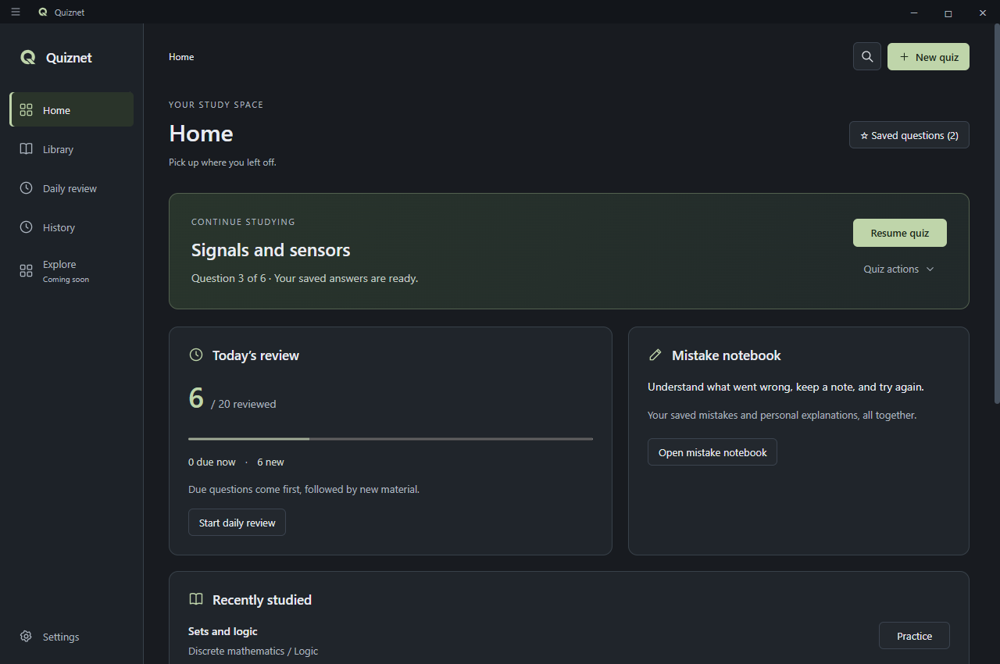
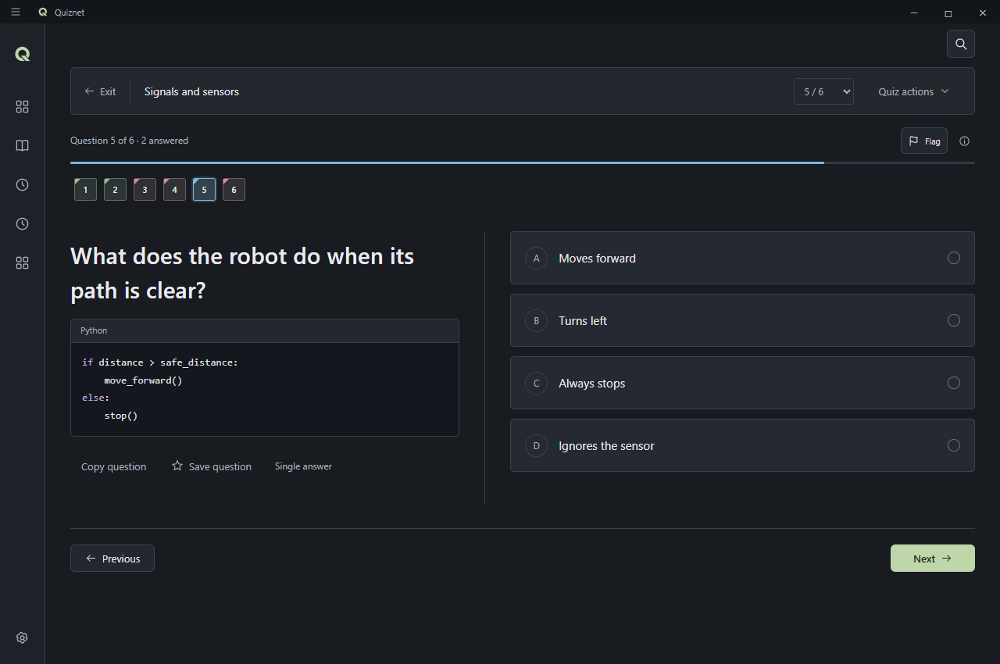
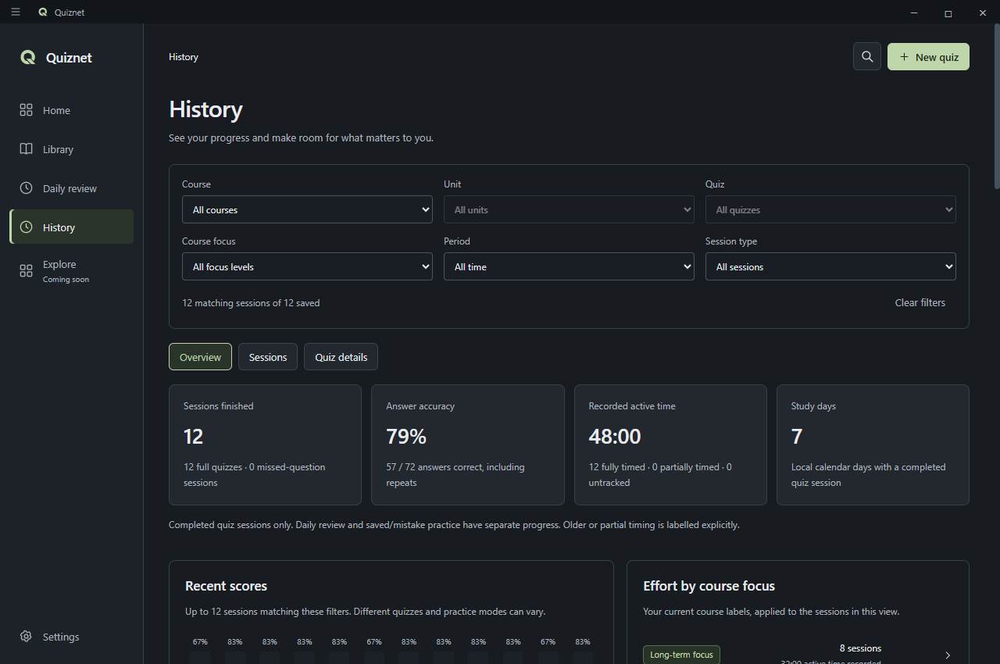

  

<h1 align="center">Quiznet</h1>

<strong>Your courses. Your quizzes. Your own computer.</strong>

An offline Windows app for studying, reviewing mistakes, and keeping your learning organized.

  <a href="https://github.com/iSariiSA/quiznest/releases/download/v1.37.0/Quiznet-Setup.exe"><strong>Download for Windows</strong></a> ·
  <a href="#get-started">Get started</a> ·
  <a href="docs/USER_GUIDE.md">Study guide</a> ·
  <a href="docs/README.md">All documentation</a>

**Windows 10/11 · x64 · Works offline · MIT licensed**

Current release: **[Quiznet v1.37.0](https://github.com/iSariiSA/quiznest/releases/tag/v1.37.0)**, a prerelease for testing and feedback. Download **Quiznet-Setup.exe**; its SHA256 checksum is attached to the release. The installer is unsigned.

## Study your way

Organize **Collections → Courses → Units → Quizzes**, create or import questions, then choose instant feedback or a test with results at the end. Home brings unfinished work and daily review together.

| Study task | What Quiznet offers |
| --- | --- |
| Keep courses organized | Collections, editable icons and colors, pinning, manual order, and long-term/for-now course focus. Library has Cards, Names only and Details views. |
| Work with different material | Single-answer, multiple-answer, true/false, written and matching questions; embedded images, Markdown, HTML, LaTeX math and highlighted code. |
| Review regularly | A daily limit and Again/Hard/Good/Easy scheduling, Saved questions with course/unit/quiz filters, and focused mistake practice. |
| Learn from a result | History dashboards and filters, missed-question practice, explanations, timing, and complete or focused Markdown study reports. |
| Use exam aids | Small book buttons open question hints or reference sheets for an entire quiz or selected questions. |
| Correct a grading mismatch | Compare a rejected written response with accepted answers, mark it correct, and optionally accept its wording in the original quiz. |
| Make it comfortable | Dark, Light and Follow Windows; separate App, Quiz, Review and Editor appearance with real-screen previews. English, Arabic and Spanish work offline. |
| Keep work safe | Saved attempts, recoverable editor drafts, local recovery points, full-library backups and a read-only library check. |

Code and math are displayed locally; snippets are never executed. AI-generated questions still need your review.

See the current Library, quiz and History screens

### Library

### Quiz

### History

## Get started

1. [Download **Quiznet-Setup.exe**](https://github.com/iSariiSA/quiznest/releases/download/v1.37.0/Quiznet-Setup.exe) and run it. It installs for your Windows account without administrator access.
2. Open **Quiznet** from the Desktop or Start menu. A fresh profile includes **Start here → Welcome to Quiznet → First steps → Discover what you can do**, one editable ten-question tour covering every question type, diagrams, code and math.
3. Choose **Practice** for feedback after each answer or **Test yourself** for results at the end. Exit to pause; Home offers **Resume quiz**.

Updates use the same installer, installation and Desktop shortcut. Existing libraries and deliberately emptied libraries keep their own material; the tour is added only to a new profile. You do not need Node.js, an account or development tools to use Quiznet.

### Add your material

Choose **New quiz** for **Write manually**, **Import file**, or **Prepare with an agent**. Select its course and unit before saving. In Library, **+** creates quizzes, courses and collections; **⋯** holds organization commands. **Ctrl + K** searches courses, units, quizzes and question text.

Try [the showcase](examples/showcase.json), [mixed choice questions](examples/mixed-questions.json), [math and diagrams](examples/math-diagrams.json), or [CSV](examples/questions.csv). The [import reference](docs/IMPORT_FORMATS.md) covers all five types and their limits.

### Prepare a quiz with an AI assistant

1. Choose **New quiz → Prepare with an agent**, set the question types, count, topics and destination, then copy or save the instructions.
2. Give those instructions and your chosen source material to an external assistant. Review its questions and answer keys.
3. Import the returned JSON file and review the questions and destination before confirming.

Quiznet does not call an AI service or upload your notes. **Copy question** copies the question, code and labelled choices without its answer key; attach any diagrams separately. [Full preparation guide](docs/USER_GUIDE.md#prepare-a-quiz-with-an-agent).

## Local data and updates

Study material, history and unfinished attempts stay in `%APPDATA%\Quiznet\data`. **Settings → Data & recovery** offers backups, restore, recovery history, library checks and the data folder. Restoring a backup replaces the current library and keeps a pre-restore copy.

Studying works offline. Optional update checking under **Settings → About** reads public GitHub release information; automatic checking starts off. It opens a release page for you to download and run the installer. [Update behavior and privacy](docs/UPDATE_CHECKING.md).

## Common questions

### How are written answers checked?

Quiznet compares your response with author-provided accepted answers after Unicode/whitespace normalization and, by default, ignoring capitalization. Authors can require case sensitivity. There is no fuzzy or AI grading. If valid wording was rejected, use **My answer is correct** after checking, compare the accepted answers, and mark it correct. You can undo the manual mark or explicitly add the wording to the original quiz. [Self-review guide](docs/USER_GUIDE.md#review-a-written-answer-yourself).

### How are choice and matching questions scored?

Multiple-answer questions require every correct choice and no extra choices. Matching requires every connection to be correct and each answer to be used once. There is no partial credit. Checked responses lock in Practice; a new attempt lets you answer again.

### How large can a quiz be?

Up to **10,000 questions**, **100 choices** per choice question, **20 accepted written alternatives**, or **20 matching pairs**. Quiz imports are limited to **20 MiB** and individual images to **2 MiB**. Practical library capacity also depends on content, memory and disk space. [Limits and recovery behavior](docs/LIMITS.md).

### Can I import documents directly?

Quiz imports accept JSON and CSV. Use the editor or an external assistant to turn PDF, Word or Markdown notes into a quiz. Markdown is also supported inside questions and in exported study reports.

### Are other platforms, Plugins or Explore available?

The packaged app supports Windows 10/11 x64. Plugins are planned; Explore has a Coming soon placeholder. See the [roadmap](docs/ROADMAP.md) for the development stage and open plans.

## Guides and support

- [Documentation index](docs/README.md) — current guides, formats, engineering notes and maintenance.
- [Study guide](docs/USER_GUIDE.md) — practice, review, appearance, language, recovery and shortcuts.
- [Report a bug or suggest a feature](https://github.com/iSariiSA/quiznest/issues) — include the app version from Settings → About and a synthetic example.
- [Changelog](CHANGELOG.md) — historical release details.
- [Contributing](CONTRIBUTING.md) — Windows development and validation. Owner-authorized updates go directly to `main`.

Quiznet is available under the [MIT license](LICENSE).
