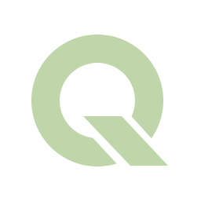
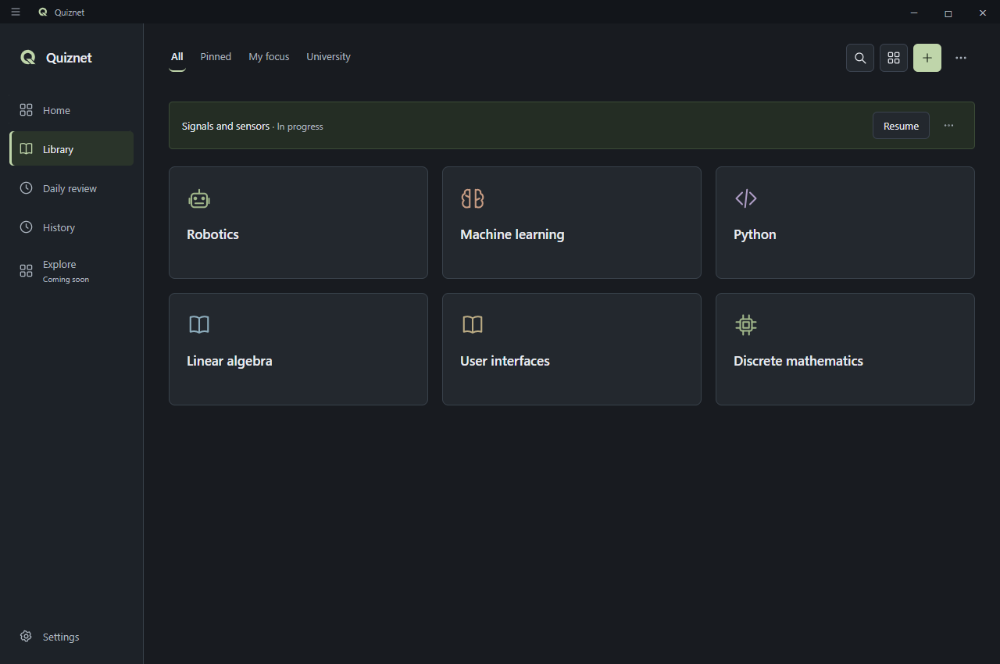

  

<h1 align="center">Quiznet</h1>

<strong>Your courses. Your quizzes. Your own computer.</strong>

An offline Windows app for turning study material into quizzes, practicing at your own pace, and learning from your mistakes.

  <a href="https://github.com/iSariiSA/quiznest/releases/download/v1.37.0/Quiznet-Setup.exe"><strong>Download for Windows</strong></a> ·
  <a href="#get-started">Get started</a> ·
  <a href="#common-questions">Common questions</a> ·
  <a href="docs/USER_GUIDE.md">Study guide</a>

**Windows 10/11 · x64 · Works offline · MIT licensed**

Current release: **Quiznet v1.37.0** — a preview for testing and feedback. The installer is unsigned. See [release notes and the installer checksum](https://github.com/iSariiSA/quiznest/releases/tag/v1.37.0).

The local maintenance build uses Electron **45.2.1** and bundles KaTeX **0.19.1** for offline math. The published download above remains v1.37.0; local updates use the same installation and Desktop shortcut.

## What is Quiznet?

Quiznet gives your study material a home: **Courses → Units → Quizzes**. Write questions, import a quiz file, or prepare instructions for an AI assistant to help create one. Then test yourself, review explanations, and return to the questions you missed.

Studying requires no account or internet connection. Optional update checks in Settings read public GitHub release information; automatic checking is off until enabled. Your questions, images, results, and unfinished attempts stay in a local library on your computer.

## What can I do with it?

Quiznet includes **Daily review**: choose quizzes, set a daily limit, and rate checked answers Again, Hard, Good, or Easy to schedule their return. Review progress stays offline and is included in library backups. See [daily review](docs/USER_GUIDE.md#daily-review).

| You want to… | Quiznet helps you… |
| --- | --- |
| Organize a subject | Choose a course and unit when adding a quiz, move quizzes between them, and search with **Ctrl + K**. |
| Make your own questions | Mix single-answer, multiple-answer, true/false, written-answer and matching questions, with explanations and up to 100 choices for choice questions. |
| Study visual or technical material | Include embedded diagrams, LaTeX math in Markdown, HTML formatting, and syntax-highlighted code. Code is displayed, never executed. |
| Choose how to practice | Use **Test yourself** for feedback after finishing or **Practice** for instant feedback. Customize timers, shuffling, navigation, and flags; save your own presets. |
| Pick up where you left off | Resume saved attempts and recover incomplete editor drafts after an interruption. |
| Learn from mistakes | Review explanations, practice missed questions, and export one Markdown study report for a tutor agent, including your answers and question timings. |
| Keep a copy or share a quiz | Export quizzes, save a full backup, browse local backup history, and check stored library integrity. |

This release includes a collapsible navigation rail, unified library search, wide question/answer layouts, full-window editing and import review, and an incorrect-answer filter in results. The instruction builder shows a live brief summary. History/results can export a complete or focused Markdown study report for another agent. Editor recovery, bounded backup history, a read-only library check, and optional GitHub release checking remain available. Math notation and prepared diagrams work offline in questions, choices, and explanations.

## Get started

Choose **Settings → Language** for **English**, **العربية** or **Español**. Languages work offline, Arabic mirrors the interface, and your study material keeps its original text. The [language guide](docs/LANGUAGES.md) explains how contributors can add more languages.

Star a question beside **Copy question**, then open **Home → Saved questions** to revisit it or practise a random selection. Filter by course, unit, or quiz to browse and practise just those saved questions. Saved copies keep their original content across quiz edits/deletion, include media and code, and travel with library backups. Unfinished saved practice resumes after reopening the app.

Use **Copy question** on a quiz or review question to copy its text, code, and all labelled choices for pasting into an AI chat. Answer keys and personal notes are omitted; attach diagrams separately. Nothing is uploaded automatically.

Quiznet opens on **Home**, with saved-session resume, today's daily reviews, Mistake Notebook access, and recent quizzes. **New quiz** groups **Write manually**, **Prepare with an agent**, and **Import file**. In **Library**, use **+** to create a quiz, course, or collection; **⋯** holds course/collection organization. Switch between **Cards**, **Names only**, and **Details** with the view button. **Settings → Appearance** controls interface size and remembered views. The search icon or **Ctrl + K** finds courses, units, quizzes, and question text. Open **Settings → Help** for the in-app guide and issue reporting. **About** is last, with the version, license, privacy information, source link and updates. Settings remains accessible when navigation is hidden.

Open **Daily review → Mistake notebook** to review mistakes across saved quizzes and daily reviews, keep a personal explanation, and practise up to 20 recent mistakes in a resumable focused session. Notes and progress are included in library backups.

**Settings → Appearance** brings **App**, **Quiz**, **Review**, and **Editor** together. Personalize fonts, text sizes, colors, layouts, cards and question markers beside a large preview of the real study screens. Try sample answers and review ratings, switch between question/code/math examples, or expand the preview to the full window. Large-text and reset controls remain available. The other Settings sections hold study defaults, History organization, local data/recovery, offline help, project links and optional updates.

### 1. Install Quiznet

1. [Download **Quiznet-Setup.exe**](https://github.com/iSariiSA/quiznest/releases/download/v1.37.0/Quiznet-Setup.exe) from the current release.
2. Run the installer. It installs for your Windows account without administrator access.
3. Open **Quiznet** from your Desktop or Start menu.

You do not need Node.js or any development tools to use the app. On the [Releases page](https://github.com/iSariiSA/quiznest/releases), choose **Quiznet-Setup.exe** under **Assets**; the source-code archives are for development.

### 2. Take your first quiz

1. In a fresh installation, open **Library → Start here → Welcome to Quiznet → First steps → Discover what you can do**.
2. Choose **Start**. In **Before you start**, select **Test yourself** or **Practice**, then start the attempt.
3. Answer the questions. Use the numbered squares or arrow keys to navigate; flag questions you want to revisit.
4. Finish to see your score, answers, explanations, and study time.
5. Choose **Practice missed questions** on the result to work on your mistakes, or return to the library and resume studying later.

New profiles start with exactly one collection, one course, one unit and one editable ten-question tour. It demonstrates all five question types, an embedded diagram, Python code, Markdown, math, HTML and useful study tools. Updates keep existing libraries as they are; the tour is not inserted into an existing or deliberately emptied library. Create your own material with **New course → New unit → New quiz**.

### 3. Add your study material

Inside a unit, **New quiz** offers three starting points:

| Option | Use it when… |
| --- | --- |
| **Write manually** | You want to enter questions, choices, and correct answers yourself. |
| **Import file** | You already have a completed JSON or CSV quiz file. |
| **Prepare with an agent** | You want instructions to give an external AI assistant along with your notes. |

For imports, try [the complete showcase](examples/showcase.json), [a small Biology quiz](examples/biology.json), [mixed choice types](examples/mixed-questions.json), [math and diagrams](examples/math-diagrams.json), or [the CSV example](examples/questions.csv). The [import reference](docs/IMPORT_FORMATS.md) explains all five types, images, Markdown, code, and limits.

## Turn notes into a quiz with an AI assistant

1. Open **Prepare a quiz** and choose the question types, count, and topics. Exact type counts update the total automatically; mixes with undecided counts show the minimum. Optional settings include difficulty, language, explanations, and source coverage.
2. Use **Save Markdown** or **Copy instructions**.
3. Give those instructions and your study material to your preferred AI assistant. Review the questions and answers it produces.
4. Import the returned `quiznet-quiz.json` file into Quiznet and confirm its destination in the preview.

**Quiznet does not call an AI service or upload your notes.** You choose what to share with an external assistant. Generated questions still need your review. See the [full preparation guide](docs/USER_GUIDE.md#prepare-a-quiz-with-an-agent).

## Common questions

### How large can a quiz be?

Quiznet supports up to **10,000 questions per quiz** and up to **100 choices per choice question**. Written questions accept up to **20 alternatives**, with **2,000 characters** per alternative or typed response; matching supports **2–20 pairs** with **1,000 characters** per side. Imports accept up to **20 MB**; individual images up to **2 MB**. Large editors and results use question groups to keep controls responsive. Whole-library backups have separate limits. See the [tested limits and stability behavior](docs/LIMITS.md).

### Does it work without internet or an account?

Yes. After downloading the installer, you can install and study offline. Quiznet has no sign-in, telemetry, or cloud sync. Using an external AI assistant is optional and separate from the app.

### Where are my questions and results stored?

In `%APPDATA%\Quiznet\data\library.json`. Open **Settings → Data & recovery → Open folder** to find it. Quiznet saves changes as you work and keeps the previous successful state in `library.json.bak`. See [local storage and recovery](docs/USER_GUIDE.md#local-storage).

### How do I back up my library or move to another computer?

Choose **Settings → Data & recovery → Save backup** and keep the file somewhere safe. On another computer, install Quiznet and choose **Restore** in Settings. A backup includes your questions, embedded media, practice history, presets, and unfinished progress.

**Restore replaces the current library.** Quiznet also keeps a separate copy of the library from before the restore. Export a single quiz instead when you want to add or share only that quiz.

### How do updates work? Will I lose my progress?

Download and run the new **Quiznet-Setup.exe**. It updates the existing installation, keeps the same Desktop shortcut, and preserves courses, questions, history, and unfinished attempts. Updates are installed manually. Saving a full backup before updating is a useful precaution.

### What happens if I close the app during a quiz?

Your saved answers and position remain available through **Resume**. Leaving the quiz or closing the app pauses study timing. Study timing is saved regularly; an unexpected shutdown may lose the time since the most recent save.

### Can I change an answer after seeing instant feedback?

Checked answers lock in **Practice** so the result reflects your first checked response. Single-answer and true/false questions check on selection. Multiple-answer, written-answer and matching questions need an explicit check before feedback, then **Continue** or **Finish**. Start a new attempt to answer again. In **Test yourself**, answers stay editable until you finish.

### How are multiple-answer questions scored?

You must select every correct choice and no incorrect choices. There is no partial credit. A question needs at least one selected answer before you can finish.

### How are written and matching answers scored?

Written answers match an author-provided accepted alternative after Unicode/whitespace normalization and, by default, ignoring capitalization. Authors can require case sensitivity. Accents, punctuation and wording still matter; no AI or fuzzy grading is used. After checking, **My answer is correct** lets you compare accepted answers and correct a rejected valid response. You can also save that wording as an accepted answer in the original quiz. Matching requires every connection to be correct, with each answer used once. Both types work offline and retain unfinished responses.

### Can I import a PDF, Word document, or Markdown notes directly?

Quiz imports accept **JSON and CSV**. Markdown is supported inside questions and in exported instructions for an external assistant. To use a chapter or document, write questions yourself or use **Prepare a quiz** with an assistant that can read your source material.

### Is Quiznet available on macOS, Linux, or mobile?

The current packaged app supports **Windows 10/11 on x64 computers**. Other platforms are not currently distributed.

### Are Plugins and Explore available?

Plugins are planned. Explore currently shows a **Coming soon** placeholder; discovery and sharing are planned. Quiznet remains in early development. See the [roadmap](docs/ROADMAP.md) for planned features.

## Guides and support

- [Study guide](docs/USER_GUIDE.md) — quiz preparation, feedback modes, flags, missed questions, timers, storage, and keyboard shortcuts.
- [Import reference](docs/IMPORT_FORMATS.md) — JSON/CSV formats, examples, images, HTML, Markdown, and code.
- [Changelog](CHANGELOG.md) — what changed between releases.
- [Report a bug or suggest an improvement](https://github.com/iSariiSA/quiznest/issues) — include your Windows version, the app version from Settings, what happened, and what you expected. Use synthetic questions; keep personal notes and backups out of public reports.

## Develop and contribute

For development setup, testing, and pull requests, see [CONTRIBUTING.md](CONTRIBUTING.md).

## License

Quiznet is available under the [MIT license](LICENSE).
