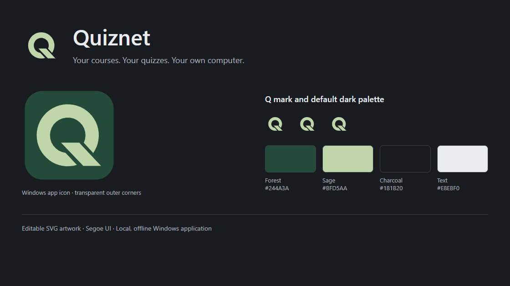

# Quiznet brand and screenshots

[Documentation index](README.md) · [Current app](../README.md)

The Quiznet identity uses a geometric Q, a forest-green app tile, pale sage accents and charcoal surfaces. The product name is **Quiznet**. Public release titles use **Quiznet v<version>**; development stages belong in repository/release metadata.

## Artwork sources

| File | Purpose |
| --- | --- |
| [mark.svg](../assets/brand/mark.svg) | Editable Q master, used without a tile inside the app. Preserve its diagonal gaps. |
| [icon.svg](../assets/brand/icon.svg) | Forest tile with transparent rounded corners and outer padding. |
| [wordmark.svg](../assets/brand/wordmark.svg) | Q with live Quiznet lettering in Segoe UI Semibold, with Arial fallback. Retain the font dependency when exporting. |
| [icon.png](../assets/icon.png) | Transparent 1024px app icon. |
| [icon.ico](../assets/icon.ico) | Separately rendered 16, 20, 24, 32, 40, 48, 64, 128 and 256px Windows frames. |

`npm run assets:brand` regenerates derived SVGs, PNG and ICO with the existing Electron/Playwright dependencies. Its isolated artwork window reads no study library and downloads no fonts or packages. Additional sizes and the artwork handoff go to ignored `outputs/Quiznet-Identity/`. Regenerate production assets only when the artwork changes; a documentation refresh can keep the app's installed icon intact.

## Default dark palette

| Role | Value | Usage |
| --- | --- | --- |
| Background | `#181B20` | Main window |
| Surface | `#23282E` | Panels, dialogs and secondary controls |
| Hover | `#2D343C` | Interactive surfaces |
| Divider | `#38414A` | Surface boundaries |
| Forest | `#244A3A` | Icon tile and brand treatments |
| Sage | `#BFD5AA` | Logo, primary buttons and focus |
| Text | `#E8EBF0` | Primary text and wordmark |
| Muted text | `#ABB4BF` | Secondary information |

The app also supports Light/Follow Windows, other accents and user-chosen course/quiz/review colors. These are appearance preferences. Use theme roles for interface surfaces and preserve explicitly chosen course colors.

## Usage

- Use the Q consistently in the title bar, sidebar, app window, installer and shortcut. Preserve `com.quiznet.desktop`, Quiznet and the existing data path.
- Keep interface lettering accessible as live text. Adjacent decorative marks have empty alt text.
- Use proportional scaling, flat fills and clear space. The app icon already includes its own padding.
- Check the actual 16–48px icon renders, Windows scaling, keyboard focus, contrast and both themes when changing production artwork.
- Keep result/error states supported by labels and symbols as well as color.

## Current screenshots

The images in [assets/screenshots](../assets/screenshots/) show **v1.37.0** and were refreshed on **9 November 2026**. All study content, courses, answers and history are synthetic. Screens are captured from the real renderer with an isolated data directory; personal libraries and exports are never used.

| Image | View |
| --- | --- |
| [home.png](../assets/screenshots/home.png) | Resume, daily progress and mistake notebook. |
| [library.png](../assets/screenshots/library.png) | Collections, course cards, icons and current toolbar. |
| [quiz.png](../assets/screenshots/quiz.png) | Code question, choices, progress and study actions. |
| [history.png](../assets/screenshots/history.png) | Filters and dashboard metrics. |
| [appearance.png](../assets/screenshots/appearance.png) | Quiz appearance controls and real-screen preview. |
| [reference-sheet.png](../assets/screenshots/reference-sheet.png) | Optional reference content with offline math. |
| [written-review.png](../assets/screenshots/written-review.png) | Written self-correction comparison and optional accepted answer. |
| [move-quiz.png](../assets/screenshots/move-quiz.png) | Current destination dialog. |
| [study-report.png](../assets/screenshots/study-report.png) | Complete/focused report export. |
| [brand.png](../assets/screenshots/brand.png) | Existing vector artwork and palette rendered for this guide. |

For future captures, use a disposable `QUIZNET_TEST_DATA` profile, current bundled source, English/default dark appearance and a consistent 1280×850 window unless demonstrating another theme, language or size. Keep actual labels and controls visible; caption customized examples clearly. Review every image for clipping and private content. Screenshot updates and documentation edits can go directly to `main` without an app release.
