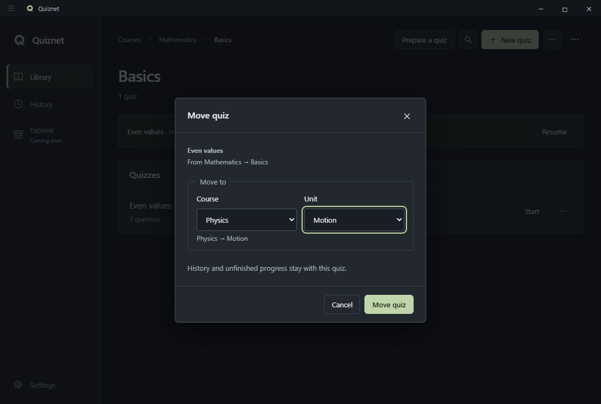
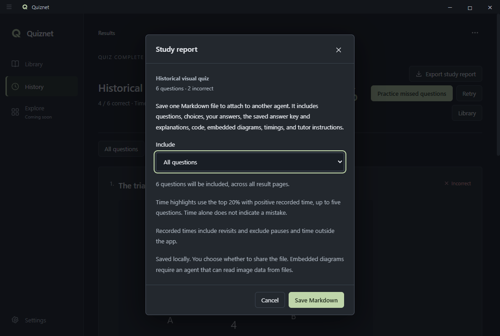

# Studying with Quiznet

[Back to the README](../README.md) · [Import format reference](IMPORT_FORMATS.md)

Detailed instructions for preparing quizzes, choosing feedback, reviewing mistakes, and keeping your library safe. For installation and a first quiz, start with the [README](../README.md#get-started).

## Find your way around

The title-bar navigation button shows or hides the navigation rail. During a quiz, the rail starts as compact icons; use the same button to expand it, then hide it completely. Library, History, Explore, and Settings remain reachable when expanded. Explore is a placeholder. The app menu stays at the upper right, including when navigation is hidden. **Search courses** filters the course list; **Ctrl + K** searches the wider library.

Wide quiz windows place the question on the left and choices on the right, with progress and flags above them. Compact windows stack the question above its choices. Resizing or hiding navigation preserves answers and the active attempt. Results offer **All questions** and **Incorrect** filters; original question numbers and saved answers stay intact, and filtering does not change the result.

Editing and import review use the full window. The editor's **Questions** list jumps to a question in the current group; question content and answer fields sit side by side on wide windows. All formats, previews, image/code attachments, and draft recovery remain available. Closing keeps the draft; Cancel discards it. Import review still keeps correct answers hidden until requested, and its filters affect browsing only. **Your brief** on the instruction screen updates as you choose the destination, count, and question types.

For large quizzes, the editor shows 25 questions per group and finished reviews show 50. Use **Edit questions** or **Review questions** to jump between groups. All questions remain part of the quiz. See [limits and stability](LIMITS.md) for file sizes, question counts, storage pressure, and failure recovery.

## Choose where a quiz belongs

Open **New quiz** inside a unit, or choose **… → New quiz…** from anywhere in the library. Choose **Write manually**, **Import file**, or **Prepare with an agent**. The **Save in** section shows the course and unit before you save, import, or generate instructions. It starts with your current location and lets you choose another existing course/unit or enter names for a **New course…** and **New unit…**.

New courses and units are created together with the quiz when you confirm **Save quiz** or **Import**. Canceling or preparing instructions leaves your library unchanged. If a course or unit name already exists in that location, Quiznet reuses it, ignoring capitalization. In the import preview, **From file** uses the file's names; choosing a course but leaving its unit as **From file** keeps the file's unit names inside that course. A multi-quiz file can also be imported into one chosen unit.

To reorganize a quiz, open its **… → Move…** menu, choose a destination, and confirm **Move quiz**. You can also create a course or unit there. Its questions, history, flags, and unfinished attempt stay with it, and you can resume normally. Moving does not delete the source course or unit.

## Prepare a quiz with an agent

Choose **Prepare a quiz** in the library toolbar, **… → Prepare a quiz…**, or **Prepare with an agent** inside **New quiz**. In **Save in**, choose an existing course/unit or name a new one. Those exact names are included in the instructions and remain selected when you use **Import quiz…**. You can change the destination again in the import preview. **Let the agent decide** lets it infer names from your material. Start with question types, count, and topics. **Choose my mix** lets you specify counts per type, such as 10 multiple-choice and 5 true/false questions, or exclude types. When all included counts are exact, changing the mix updates the total automatically. Undecided counts show a minimum, with at least one question per included type; an explicit total grows if the mix needs more questions. **Ask me** totals remain a question for the agent to resolve.

**Advanced** contains difficulty, ideas per question, thinking skills, source coverage, learner level, any quiz/code language, images, code questions, option count, explanations, source references, excluded topics, and the quiz name. Each preference defaults to **Let the agent decide**. Choose **Ask me** to require a question before generation, or set a specific value. Difficulty and connected reasoning are separate choices. Selecting **No code** clears and disables the code-language preference; allowing code enables it again.

Use **Save Markdown** for `Quiznet-instructions.md`, or **Copy instructions**. **Preview** shows the exact instructions. Give those instructions and your chapter or notes to your preferred agent. The instructions require the agent to resolve Ask choices together, wait for answers, use the supplied sources, and produce one complete `quiznet-quiz.json` file. Import it with **Import quiz…** or the app menu. Source references can be included in the generated explanations.

Quiznet does not call an AI service or upload material. Draft preferences stay in memory while the app is open; saving/copying instructions does not change your library. You choose what to share with the external agent. Generated answers still need your review. Agents without image-file tools may need to ask for an embedded image or permission to omit it. The exported instructions include the real import schema, limits, examples, and a final validation checklist; they cannot guarantee another agent follows them.

## Before starting a quiz

Start, Retry, Shuffle & start, and **Practice missed questions** open a compact **Before you start** dialog. Choose **Test yourself** for review after finishing or **Practice** for instant feedback with the total timer hidden. Change feedback, total/question timer visibility, question squares, the progress bar, flags, and shuffling independently. **Save as…** stores a named preset locally; saving the same name updates it. Select a saved preset to reuse it or delete it with the trash button. Changes to a running attempt are independent of later preset edits/deletion. Resume continues the existing attempt and choices.

In review mode, answers stay editable and nothing is graded on the quiz screen. Instant mode checks single-answer and true/false responses as soon as you choose; multiple-answer questions use **Next** after you finish selecting. Next shows feedback on the current question; **Continue** moves on, or **Finish** ends the quiz after feedback on the last question. Feedback shows Correct/Incorrect, the correct answer when needed, and the explanation. Checked answers lock, including after revisiting, restarting, or restoring a backup, so the score reflects the first checked response. Every answer must be checked before an instant-feedback attempt finishes. Retry opens fresh choices and a new attempt.

Completed review is available in both modes. History and results label instant-feedback attempts; previous-attempt comparisons use the same feedback mode. Hiding timers affects the live quiz only: totals and question times remain available in review. The question timer includes all visits and time reading feedback.

## Questions, flags, and mistakes

The compact numbered squares jump directly to a question. Blue marks the current question, green an answered question, orange a flag for review, and red an unanswered question. States use small corner triangles on neutral squares. Open **Question status help** (the info button) for the meanings. These colors describe progress, not correctness; review mode never reveals the answer through the squares. The current square keeps an orange dot if flagged. Instant-mode multiple answers count as answered only after checking. Text labels and accessible names explain each state.

The thin progress line shows your current question’s position; the adjacent count shows how many questions are answered. Large quizzes display groups of up to 100 squares with group navigation. The normal question dropdown and arrow-key navigation remain available when squares are hidden. The flag icon/button sits beside the progress controls. Choose **Flag** to mark uncertain answers and **Review flags** to jump through them. Before submitting a fully answered quiz with remaining flags, choose to review them or finish. Flags persist with unfinished progress and are cleared when that attempt ends.

**Practice missed questions** on a result starts a new attempt using only that result’s incorrect answers. Its default preset is Practice, and all start choices remain editable. It uses the saved historical question content even after editing the live quiz, preserves media/code, and leaves the original quiz and result unchanged. The new result has its own score, timing, and a Missed questions title. It does not inflate the full quiz’s Best score. Perfect results have no missed-question button. Previous-attempt comparisons use the same feedback mode, question set, and full/missed-only scope. Saved presets, active review flags, and missed-question progress are included in library backups.

## Quiz timing

The quiz header has a small stopwatch that counts up with no time limit or effect on your score. It measures time while the quiz screen is open, including time spent reconsidering answers. Leaving the quiz for another screen or closing the app pauses it; Resume continues from the saved total. Minimized windows and temporary dialogs still count while the quiz remains open.

Each question records the time you spend viewing it, including revisits. Question timers are hidden during the quiz by default; enable **Show question timer** before starting to display the current question’s accumulated time. They also appear as **Time spent** in the finished review. Results and history show total time. Results compare your score and time with the previous attempt at the same questions; timing comparisons require complete active-study timing on both attempts. Editing a quiz starts a new set of questions for comparisons.

If a result shows **Tracked time**, timing covers only part of that attempt. Timing is saved on answers, navigation, and normal closing, with a checkpoint every 15 seconds while studying. A crash may lose time since the latest save.

## Take a study report to an agent

After finishing, choose **Export study report** on the results screen. You can return later through **History → open an attempt → Export study report**. Choose **All questions** or **Mistakes and most time spent**, then **Save Markdown**. Attach the saved `.md` file to your preferred agent and ask it to help you review; tutor instructions are already included.

The report contains the saved questions and choices, your selected answers, the saved correct answers and explanations, code, math notation, embedded diagrams, the score, feedback mode, and recorded question times. It uses that completed attempt's snapshot, so later quiz edits do not replace the historical content. Review filters and visible result pages do not limit the export; only the report's **Include** selection does. Nothing is uploaded automatically, and exporting does not change your library or results.

**Most time spent** highlights the top 20% of questions with positive recorded times, rounded up and capped at five. Equal times use original question order. This is a review aid, not a claim that a long answer was wrong or difficult. Missing times in older attempts stay unknown; partial timing is labelled. Correct questions can be included among the time priorities.

Everything is kept in one Markdown file. Diagrams use embedded raster data URLs; an agent may need file/image tools to decode them. The report instructs it to ask for an image if it cannot inspect one. Content is quoted as source text so original code, HTML, and LaTeX remain available without execution. Reports have a 20 MiB limit; oversized reports fail visibly without truncating questions. Try the priority selection if a complete report is too large.

## Local storage

Your library lives in `%APPDATA%\Quiznet\data\library.json`. **… → Settings → Open folder** shows its exact location.

Quiznet saves changes automatically. `library.json.bak` holds the previous successful state. If the main file is missing or damaged, Quiznet recovers the previous state when possible, preserves the backup, and keeps any damaged file. If neither file is valid, Quiznet preserves the available files and reports the problem instead of silently resetting your library.

Edited quizzes also get a separate recovery draft after a short pause in typing. **Draft saved on this device** confirms it reached storage. The draft can contain incomplete questions, code, images, and unsaved course/unit names. Closing the editor with its close button or Escape keeps the draft; **Cancel** discards it. **Recover draft** reopens saved work after a restart or display crash. Save the finished quiz to clear its draft. There is one recovery draft at a time; recover or discard it before starting another editor session. A hard shutdown can lose edits since the last confirmed draft save. Agent instruction preferences still last only while the app is open.

**Settings → Backup history** shows local recovery points and offers **Create backup now** and previewed restores. Quiznet saves the previous state before the first library change each UTC day and before imports, deletions, and restores. It keeps up to seven copies within 128 MB; a newest copy larger than that is retained alone. These are whole-library copies: restoring also restores the saved history and unfinished attempt. It replaces the current library after confirmation, preserving the previous state first. Store occasional exported backups on another drive as well.

**Settings → Check library** reads the current library and rolling backup, reports structural validity and study-item counts, and changes neither file. Missing backup means no rolling copy exists yet; damaged means the file needs attention. The check does not verify answers or disk hardware.

The import preview lists type counts and warns about exact repeated content, questions already in the library, and missing explanations. Question preview lets you select a quiz, browse with Previous/Next, or enter a question number before confirming Import. It shows the full question, choices, images, formatting, and code. Correct answers and explanations start hidden; select **Show correct answer** to reveal them or **Hide correct answer** to hide them again. Browsing or reopening the preview hides them again. Choose **Needs review** to browse flagged questions, and use related-question links to compare repeated questions or conflicting answer keys. Destination choices stay selected as you browse. The filter affects only the preview: final Import still imports every question in the file. Cancel or closing the dialog leaves the library unchanged.

Development review notes also flag possible placeholders, choices differing only by case/spacing, every choice marked correct, and images without descriptions. Some notes are optional or intentional; they do not block an otherwise valid import. Previewing a formatted question can also flag prompt/option text that becomes invisible after safe formatting. Those display checks run as you browse, so inspect the questions rather than relying only on the initial flag count. Invalid JSON, missing required fields, or invalid answer indices still stop the import before confirmation. Importing from **Prepare a quiz** also compares the file against a valid current brief's total and type choices. Warnings leave the decision to you and import every question; they do not check factual correctness. Briefs saved outside this app session are not automatically matched to imported files.

Restoring a backup also saves `before-restore-<timestamp>.json` in the data folder. These files may contain your study material; copy or manage them as you would any personal document.

To move to another computer, install Quiznet there and use **Save backup** and **Restore** in Settings. Updating or uninstalling the app keeps the data folder.

## Optional update checks

Open **Settings → Check for updates** to check the public GitHub release source. Turn on **Check automatically every two days** if you want checks while the app is open; it starts off. No account is needed and no study material is uploaded. An offline or failed check leaves studying available.

A newer published installer offers **Download update**, **Later**, and **Skip this version**. Later (or closing the notice) postpones it for 24 hours. Skip hides that version's automatic notices; manual checks can still show it. Notices wait until you leave the quiz and finish any open dialog. Download opens the GitHub release page in your browser; run `Quiznet-Setup.exe` when ready to update the same installed app. Installation never starts automatically. The installer is currently unsigned.

Only published releases with the expected installer can be detected. A local development build can be newer than the public release and correctly report that no newer published installer is available. API rate limits may require waiting before retrying. Preferences apply to this computer and are separate from library backups.

## Keyboard shortcuts

| Shortcut | Action |
| --- | --- |
| Ctrl + K | Search courses, quizzes, units, and question text (close the current dialog first) |
| 1–9 | Select or toggle the corresponding answer while taking a quiz |
| Tab, Shift + Tab, Space / Enter | Reach and select any choice, including beyond the first nine |
| Left / right arrows | Move between questions |
| Escape | Close a dialog |

## Study math and diagrams offline

Choose **Markdown** as the question format. Use `$x^2$` for inline math and `$$...$$` on separate lines for a displayed equation. Fractions, roots, vectors, matrices, sums, integrals, and aligned steps work in the question, choices, and explanation. A fenced `math` block also works. Open **Preview** in the editor to inspect the result. An unsupported formula shows **Check formula** and the source so it can be corrected.

Use **Add image** for a prepared geometry diagram or graph. Agents can embed diagrams directly in the imported quiz, including Markdown images in choices or explanations. Keep solution diagrams in the explanation; import preview hides these until **Show correct answer**. All math fonts and embedded images stay available offline. Quiznet displays prepared notation and diagrams without running Python or solving the question for you.

Try [math-diagrams.json](../examples/math-diagrams.json), which includes a labelled triangle, a matrix, and an integral. The [import reference](IMPORT_FORMATS.md#math-and-prepared-diagrams) covers JSON escaping and display limits.
