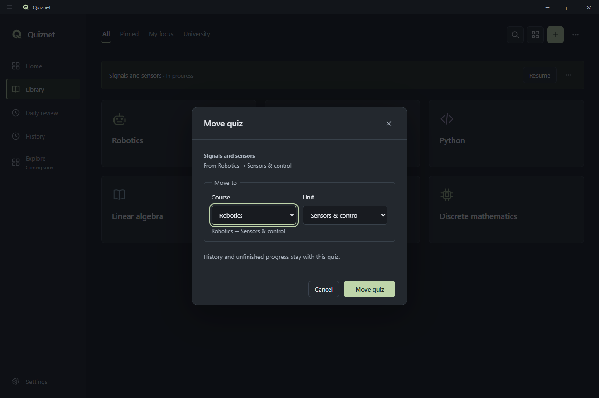
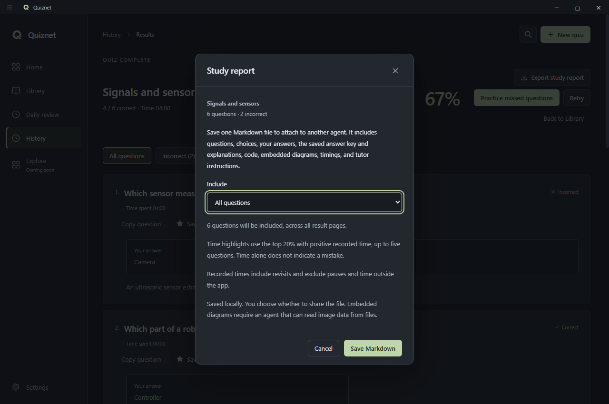

# Studying with Quiznet

[Back to the README](../README.md) · [Import format reference](IMPORT_FORMATS.md)

Detailed instructions for preparing quizzes, choosing feedback, reviewing mistakes, and keeping your library safe. For installation and a first quiz, start with the [README](../README.md#get-started).

## Find your way around

A fresh profile has one **Start here** collection, one **Welcome to Quiznet** course, one **First steps** unit and one **Discover what you can do** quiz. Its ten short questions let you try all five types, a picture, code, math and formatted text, with explanations that introduce study tools. Choose Practice for feedback as you explore. This is editable material, not a locked tutorial. Existing libraries and deliberately emptied libraries are never repopulated during an update.

Settings has **Appearance**, **Language**, **Study**, **History**, **Data & recovery**, **Help**, and **About** sections. Appearance contains **App**, **Quiz**, **Review**, and **Editor** categories. **Search settings** finds individual controls and opens the matching category, including through English terms while using another language. Narrow windows wrap the section links above the controls.

In **Language**, choose **English**, **العربية** or **Español**. Search accepts native or translated language names and ignores accents. The interface changes immediately and remembers the choice on this device. Languages are included in the installer and work offline. Arabic puts navigation on the right and mirrors quiz navigation; Latin, Arabic-Indic and Persian answer digits work. Code and math retain their reading direction. Questions, choices, course names, notes, copied content, exports and unfinished answers keep their original content. Interface language and the instruction builder's **Quiz language** are independent. If a language file is unavailable, Quiznet opens in English and preserves your preferences and study files. Native language names remain visible in the selector. Some technical diagnostics and the original MIT license remain in their source language.

In **Appearance → App**, choose **Dark**, **Light**, or **Follow Windows**, an accent color, reading-text size and compact/comfortable spacing. The preview and app update as you change them. **Interface size** resizes the whole interface; **Text size** adjusts reading text. Library view/remembering controls are in the same category. **Reset display** restores these app defaults and the library layout without changing study material or the separate Quiz/Review/Editor choices.

In **Study**, save defaults for the next full-quiz attempt, including feedback, timers, navigation, flags, question shuffling and answer-choice shuffling. The start dialog can override them. Unfinished attempts retain their captured choices and answer order even after defaults change; keyboard answer shortcuts follow the visible order. Missed-question practice still starts with its Practice preset. Daily-review limits and selected quizzes can also be changed here without resetting the day’s count or schedule.

In **History**, choose a default dashboard tab, remember filters between launches, and group displayed sessions by course or collection. **Manage history…** filters completed sessions by course, collection and dates. Select individual rows or **Select matches** (up to 10,000); export CSV summaries or **Preview removal…**. CSV contains dates, course/collection/unit, score and timing summaries; questions remain available through individual Study reports. Removal keeps quizzes, saved question copies and review schedules, and saves a recovery point first. A result needed by unfinished missed-question practice is protected. Restoring the recovery point restores the whole saved library, so it also replaces any changes made since that point.

**Data & recovery** shows the sizes of known study/preference files and counts of courses, quizzes, questions and completed sessions. It includes backup/restore, recovery history, library health and the data folder. Choose 3/7/14/30 recovery copies and a 64/128/256/512 MB budget; limits take effect when a new recovery point is made. The newest copy is retained even if it alone exceeds the budget. Exported backups and older before-restore files are separate.

**Help** offers searchable offline guides, FAQs and shortcuts; **Open help** opens the full quiz-format reference. **Report an issue** is here too. **About** is the last section, with the technical version, platform, public maintainer, privacy/local-data information, full MIT license, credits, source link and updates. Project buttons open a fixed page in your browser without attaching study material. Appearance, study defaults, remembered History choices and retention limits belong to this device; library backups retain the study records themselves.

Quiznet opens on **Home**. **Continue studying** prioritizes your unfinished quiz, then an unfinished focused mistake review, then a saved or available daily review. Each resumes its own saved answers and place. Returning Home from a quiz pauses its study timer.

**Today's review** shows your rated answers against the daily limit, questions due now, new questions, and the next action. Counts refresh while Home stays open, including at local midnight. **Mistake notebook** opens saved mistakes and notes. **Recently studied** shows up to five live quizzes, once each, with their latest result; **View result** opens that saved attempt and **Practice** opens the usual start-options dialog. Deleted quizzes are omitted. A quiz without a completed attempt does not appear yet.

Use **New quiz** to choose **Write manually**, **Prepare with an agent**, or **Import file**. These three routes share the same current course and unit. Saved editor drafts remain recoverable on Home. Choose **Library** in the sidebar for courses and units; choose **Home** or the Quiznet logo to return. Opening Home does not change your library or review schedule.

The title-bar navigation button shows or hides the navigation rail. During a quiz, the rail starts as compact icons; use the same button to expand it, then hide it completely. Library, History, Explore, and Settings remain reachable when expanded. Explore is a placeholder. **Search library** stays at the upper right. **New quiz** groups the three quiz creation routes; in the Library overview choose **+ → New quiz…**. Creation is hidden while answering questions or preparing a brief, and on Settings/Explore. Settings uses its own search; Ctrl+K still opens Library search. **Settings** is in the sidebar and appears in the header when navigation is hidden. Open **Settings → Help → Open help** for the guide. Search once across course names, unit names, quiz titles, and question text with **Search library** or **Ctrl + K**; each result identifies its type and location. Empty units appear too. **Library actions (⋯)** is in the Library toolbar; **Course actions** and **Unit actions** sit beside their page titles. Use **+ → New course…** or **Course actions → New unit…** to create empty folders. New quiz can also create its course and unit when you save. Quiz rows retain their individual **…** menus. **Quiz actions** beside a running quiz or Home resume card, and the unfinished-quiz banner menu, contain **Discard attempt…**. Saved questions, mistake reviews, and results show their parent location in the breadcrumbs.

Wide quiz windows place the question on the left and choices on the right in English and Spanish; Arabic mirrors those columns. Progress and flags sit above them. Compact windows stack the question above its choices. Resizing or hiding navigation preserves answers and the active attempt. Results offer **All questions** and **Incorrect** filters; original question numbers and saved answers stay intact, and filtering does not change the result.

Editing and import review use the full window. The editor's **Questions** list jumps to a question in the current group; question content and answer fields sit side by side on wide windows. All formats, previews, image/code attachments, and draft recovery remain available. Closing keeps the draft; Cancel discards it. Import review still keeps correct answers hidden until requested, and its filters affect browsing only. **Your brief** on the instruction screen updates as you choose the destination, count, and question types.

## Personalize Appearance

Open **Settings → Appearance** and choose **App**, **Quiz**, **Review**, or **Editor**. Controls sit beside a large preview at the actual reading size. **Expand** opens it across the window; its layout responds to the available width just like a real study screen. Change the sample between **Question**, **Code**, and **Math**. In Review, switch between **Daily review** and **Quiz results**. These are synthetic samples: answering, navigating, flagging, checking and rating in the preview never changes your own questions, attempts, daily allowance or schedules. Editor samples are read-only and never create a recovery draft.

Changes apply immediately on this device. **Follow app** and **Use app color** keep existing defaults. Text sizes also follow the global Text size and Interface size controls. Controls and previews scroll independently on wide windows; narrow windows place the preview above the controls.

- **Quiz:** choose question and answer text sizes, a local reading font, line spacing, question/answer layout, answer spacing, card corners and answer-letter shapes. Set text and background colors independently. Side by side becomes stacked in narrow windows. Chosen answers and grading feedback retain their status styling.
- **Question markers** inside Quiz: choose squares, rounded squares or circles, their size, and current/answered/flagged/unanswered colors. Markers use state tints and a current-question ring; circles keep flags in a separate badge. Markers show progress and flags; keyboard navigation and the question menu remain available. Hiding question squares is still a separate start option.
- **Review:** independently change question/answer sizes, local font, line spacing, card corners, compact/roomy spacing, focused/wide reading width and text/card/status colors. These apply to daily review, saved/mistake practice and result cards. Following app retains the earlier inherited style until you choose an override. Review schedules, grading and recall ratings keep their existing behavior.
- **Editor:** choose source-field text size, font, spacing, colors, automatic columns or one column, and question-number badge shape. Code has a separate size/font and optional display wrapping. Wrapping does not insert line breaks into saved or copied source.

**Large-text preset** enlarges quiz/review reading, editing, code and navigation without replacing chosen colors or shapes. Quiz, Review and Editor each have a reset; **Reset markers** affects navigation only. **Reset all study appearance** restores all three categories while keeping App settings, the main theme, interface size and other settings. These preferences live outside library backups. They do not edit question content, scores, unfinished answers or recovery drafts.

For large quizzes, the editor shows 25 questions per group and finished reviews show 50. Use **Edit questions** or **Review questions** to jump between groups. All questions remain part of the quiz. See [limits and stability](LIMITS.md) for file sizes, question counts, storage pressure, and failure recovery.

## Choose where a quiz belongs

Choose **New quiz** from Home or a browsing page. Inside a course or unit it starts with that location selected. Choose **Write manually**, **Import file**, or **Prepare with an agent**. The **Save in** section shows the course and unit before you save, import, or generate instructions. It starts with your current location and lets you choose another existing course/unit or enter names for a **New course…** and **New unit…**.

New courses and units are created together with the quiz when you confirm **Save quiz** or **Import**. Canceling or preparing instructions leaves your library unchanged. If a course or unit name already exists in that location, Quiznet reuses it, ignoring capitalization. In the import preview, **From file** uses the file's names; choosing a course but leaving its unit as **From file** keeps the file's unit names inside that course. A multi-quiz file can also be imported into one chosen unit.

To reorganize a quiz, open its **… → Move…** menu, choose a destination, and confirm **Move quiz**. You can also create a course or unit there. Its questions, history, flags, and unfinished attempt stay with it, and you can resume normally. Moving does not delete the source course or unit.

## Prepare a quiz with an agent

Choose **New quiz → Prepare with an agent**. In **Save in**, choose an existing course/unit or name a new one. Those exact names are included in the instructions and remain selected when you use **Import quiz…**. You can change the destination again in the import preview. **Let the agent decide** lets it infer names from your material. Start with question types, count, and topics. **Choose my mix** lets you specify counts per type, such as 10 multiple-choice and 5 true/false questions, or exclude types. When all included counts are exact, changing the mix updates the total automatically. Undecided counts show a minimum, with at least one question per included type; an explicit total grows if the mix needs more questions. **Ask me** totals remain a question for the agent to resolve.

**Advanced** contains difficulty, ideas per question, thinking skills, source coverage, learner level, any quiz/code language, images, code questions, option count, explanations, source references, excluded topics, and the quiz name. Each preference defaults to **Let the agent decide**. Choose **Ask me** to require a question before generation, or set a specific value. Difficulty and connected reasoning are separate choices. Selecting **No code** clears and disables the code-language preference; allowing code enables it again.

Use **Save Markdown** for `Quiznet-instructions.md`, or **Copy instructions**. **Preview** shows the exact instructions. Give those instructions and your chapter or notes to your preferred agent. The instructions require the agent to resolve Ask choices together, wait for answers, use the supplied sources, and produce one complete `quiznet-quiz.json` file. Import it with the next-step **Import quiz…** link on your brief, or **New quiz → Import file**. Source references can be included in the generated explanations.

Quiznet does not call an AI service or upload material. Draft preferences stay in memory while the app is open; saving/copying instructions does not change your library. You choose what to share with the external agent. Generated answers still need your review. Agents without image-file tools may need to ask for an embedded image or permission to omit it. The exported instructions include the real import schema, limits, examples, and a final validation checklist; they cannot guarantee another agent follows them.

## Question types

The editor's **Question type** selector offers five types. The same types work in imports, ordinary attempts, Daily review, Saved questions, Mistake notebook, results, backups and study reports. Prompts and explanations support Text, Markdown or safe HTML; images and code remain available for every type.

- **Single answer:** choose one option. **Multiple answers:** select the exact correct set without extra choices; click again to deselect. **True / false:** choose between two editable labels.
- **Written answer:** type a short response of up to 2,000 characters. Authors provide 1–20 accepted alternatives and can turn on case sensitivity. Matching uses Unicode NFKC, trims/collapses whitespace and normally ignores capitalization. Accents, punctuation and wording still matter. Add equivalent variants in the editor rather than relying on meaning or spelling guesses; Quiznet uses no AI or fuzzy grading. Accepted alternatives stay hidden until answer feedback/reveal.
- **Matching:** connect each left item with one right-hand answer using the keyboard-accessible selectors. The right-hand choices are mixed and remain stable while you answer or resume. Each answer is used once; choosing an answer assigned elsewhere clears its earlier connection. All pairs must be correct for credit. Authors enter 2–20 correct pairs; pair labels are plain text up to 1,000 characters per side.

Written responses and unfinished connections save with the attempt; incomplete answers remain incomplete after restarting. Pausing, leaving or closing waits for pending response saves. A completed test needs every question answered, and a completed instant-feedback attempt needs every answer checked. Response fields do not execute code or evaluate typed formulas. Question copying omits accepted written alternatives and correct matching connections; matching item sets are listed separately. Reports intentionally include your saved responses and the reference answers for review.

## Before starting a quiz

Start, Retry, Shuffle & start, and **Practice missed questions** open a compact **Before you start** dialog. Choose **Test yourself** for review after finishing or **Practice** for instant feedback with the total timer hidden. Change feedback, total/question timer visibility, question squares, the progress bar, flags, and shuffling independently. **Save as…** stores a named preset locally; saving the same name updates it. Select a saved preset to reuse it or delete it with the trash button. Changes to a running attempt are independent of later preset edits/deletion. Resume continues the existing attempt and choices.

In review mode, answers stay editable and nothing is graded on the quiz screen. Instant mode checks single-answer and true/false responses as soon as you choose. Multiple-answer, written-answer and matching responses require an explicit check after you finish selecting, writing or connecting. Feedback appears on the current question; **Continue** moves on, or **Finish** ends the quiz after feedback on the last question. Feedback shows Correct/Incorrect, the reference answer and the explanation. Checked answers lock, including after revisiting, restarting, or restoring a backup, so the score reflects the first checked response. Every answer must be checked before an instant-feedback attempt finishes. Retry opens fresh choices and a new attempt.

Completed review is available in both modes. History and results label instant-feedback attempts; previous-attempt comparisons use the same feedback mode. Hiding timers affects the live quiz only: totals and question times remain available in review. The question timer includes all visits and time reading feedback.

## Course study focus and History dashboard

History and course organization are included in Quiznet v1.28.0; see [FEATURE_BATCH.md](FEATURE_BATCH.md) for the completed validation summary.

On a course page, choose **Course actions → Study focus…**. Choose **Long-term focus** for subjects you want to keep building on, **For now** for material you need to finish now, **Low priority** for material you want to put aside, or **Not set** to clear the label. Assigned focus appears as a compact course summary and in Library/History, and travels with library backups. Your existing daily-review selections and unfinished practice remain as configured.

History has **Overview**, **Sessions**, and **Quiz details** views. Filter by **Course → Unit → Quiz**, course focus, period/custom dates, and full versus missed-question sessions. Changing a parent resets its child filters; **Clear filters** shows all sessions again. Filters remain selected while browsing results during the app session.

Overview shows completed quiz sessions, accuracy across all answered questions including repeats, recorded active time, local study days, recent scores, effort by focus, and full-quiz coverage. Recorded time excludes older wall-clock estimates; partial and missing timing are identified. Daily review and saved/mistake practice retain their separate progress. Quiz details shows the latest and best full-quiz scores under the selected filters. Open a session for its historical questions/answers, per-question timing where available, comparisons, and report export.

Course labels and quiz locations use your current organization, including when looking at older sessions. Unlinked legacy sessions remain available through the course filter. Changing labels or browsing the dashboard does not alter past questions, answers, or scores.

## Collections, icons, colors and ordering

Collections are the level above courses. In Library choose **+ → New collection…**, give it a name such as “AI & Robotics” or “University requirements”, and choose an icon and colors. Use the collection tabs to browse one collection, **All**, **Pinned**, or **Unsorted** courses. Existing courses start unassigned until you move them. Selecting a collection shows its larger heading and its own options menu.

The **view button** beside Search switches between **Cards** (icons and names), **Names only** (a compact list), and **Details** (collection, study focus, unit counts and quiz counts). Cards and Names only omit these extra labels. A course's **⋯** options appear on hover or keyboard focus; they remain reachable using Tab and provide appearance, collection, focus, pinning, ordering, History, new unit, rename and delete actions. Opening a course is a separate button, so choosing its options does not open it.

In **Settings → Appearance**, choose the library view, turn **Remember my library view** on or off, and change **Interface size** from 90% to 125% to resize text and controls throughout the app. When remembering is off, the current view lasts for this run and the next launch starts with Cards. **Reset display** restores Cards, remembering on, and 100% size. These preferences belong to this device and are separate from library backups. At narrow sizes, collection tabs scroll; the Details table has its own horizontal scroll area.

On a course page choose **Course actions → Appearance & collection…**. Choose its collection, a built-in icon or **Emoji or symbol**, and independent icon/name colors. The preview updates before saving. The default-color checkboxes retain the original palette/theme colors; changing a color turns off that default. Emoji use their native colors. **Reset appearance** restores the default book icon and original/theme colors while keeping the selected collection.

Choose **Library actions (⋯) → Organize courses…** to pin/unpin courses and move them up or down. Pinned courses appear first in the current view and are also available through the Pinned tab; they appear only once in the course list. Their order can be changed among the pinned items. Other courses move within their own collection (or within Unsorted courses). Appearance and collection can also be changed from this dialog.

Use **Library actions (⋯) → Manage collections…** or a selected collection's **Collection actions (⋯)** to edit, pin/unpin, reorder or remove a collection. Pinned collections appear before other collection tabs. Removing a collection returns its courses to Unsorted courses; it does not delete the courses, quizzes, attempts or progress. Organization, icons, colors and pins travel with library backups. Old app versions may discard this optional metadata, so keep a backup before any rollback.

## Saved questions

Filter your collection with **Course → Unit → Quiz**. Choose a course to enable its units, then a unit to enable its quizzes. **All units** or **All quizzes** includes everything under the selected parent; **Clear filters** shows the full collection. The count and pages show only matching saved questions. Changing a parent clears the child selections and hides any revealed answers.

**Practise saved questions** starts a round using only the matching copies, with the question count limited to the matches. An unfinished round keeps its original question selection when you change filters or restart the app; finish or end it before starting a different selection. Filters themselves last for the current app session and do not rewrite the library.

Newly starred questions retain their source course/unit/quiz. Existing copies are linked using identical live question content or historical quiz snapshots, without modifying them. Identical questions can appear under more than one matching quiz while remaining one saved copy. Live sources follow renames and moves; after deletion, newer copies retain the source recorded when starred. Older copies with no identifiable source remain under **All courses → Unlinked questions**. Their questions, explanations, and practice progress stay available.

Use the star beside **Copy question** to save a question from a quiz, a historical result, Daily review, Mistake Notebook, or focused practice. You can save unanswered or correctly answered questions too. A filled star means **Saved**; select it again to remove the bookmark. Open **Home → Saved questions** to browse the collection. Opening the collection and revealing answers changes no study progress.

Each saved question is a separate snapshot of its wording, choices, answer, explanation, formatting, code, and embedded diagrams. It stays available if the original quiz moves, changes, or is deleted. Exactly matching question content shares one star across copies; changing the content gives it a different identity, so both versions can be saved. Removing a bookmark leaves the original quiz, results, and Mistake Notebook notes unchanged. Removal from the collection asks for confirmation and keeps a recovery snapshot.

The collection shows 20 questions per page, newest saved first. **Show answer and explanation** reveals the saved answer; it starts hidden when you open the collection or change pages. **Copy question** keeps the existing question-and-choices-only behavior, including the reminder to attach diagrams separately.

Choose **Practise saved questions**, set **Questions this round**, then start. Quiznet randomly chooses up to 100 distinct saved questions; the default is 20 or the collection size if smaller. Choose your answer, check it, read the explanation, and continue. Multiple answers require the exact correct set. Checked answers lock. **Pause saved practice** preserves the current question and selections; resume from Home or the collection, including after reopening Quiznet. Finishing shows that round's score without adding an ordinary quiz attempt, consuming daily allowance, or changing spaced-review intervals.

Questions in an unfinished saved round cannot be removed until you finish it or use **End saved practice…** in the collection. Ending discards only that unfinished round; its saved questions stay available. Saved copies, the unfinished round, and the most recent saved-practice score are included in **Save backup**, automatic recovery, and **Restore**. The collection supports 20,000 saved questions within 64 MiB; a full collection reports an error and leaves the last successful save intact. Remove an unneeded saved copy to free space. Keep a backup before rolling back to an older app build that may discard the optional saved-question field.

## Questions, flags, and mistakes

Choose **Copy question** while taking a quiz, reviewing a result, using Daily review, or browsing/practising your Mistake Notebook. Paste into your preferred AI chat to ask for help. The copied text includes the full question, code attachment, question-type instructions, and every choice labelled A, B, C, D and onward. It leaves out the saved answer key, your selected answer, explanations, and personal notes. For a historical result it uses that attempt's saved question, even after editing the quiz.

Markdown and math remain in their original source notation; HTML becomes readable text with paragraph/line breaks. Images become descriptions with a reminder to attach the image separately in your chat. No image is uploaded or placed on the clipboard automatically. Copying changes no quiz answers or library data; you choose where to paste it. Plain-text copies are limited to 20 MiB, with an explicit error and no clipboard overwrite when the limit is exceeded.

The compact numbered squares jump directly to a question. Blue marks the current question, green an answered question, orange a flag for review, and red an unanswered question. States use small corner triangles on neutral squares. Open **Question status help** (the info button) for the meanings. These colors describe progress, not correctness; review mode never reveals the answer through the squares. The current square keeps an orange dot if flagged. Instant-mode multiple answers count as answered only after checking. Text labels and accessible names explain each state.

The thin progress line shows your current question’s position; the adjacent count shows how many questions are answered. Large quizzes display groups of up to 100 squares with group navigation. The normal question dropdown and arrow-key navigation remain available when squares are hidden. The flag icon/button sits beside the progress controls. Choose **Flag** to mark uncertain answers and **Review flags** to jump through them. Before submitting a fully answered quiz with remaining flags, choose to review them or finish. Flags persist with unfinished progress and are cleared when that attempt ends.

**Practice missed questions** on a result starts a new attempt using only that result’s incorrect answers. Its default preset is Practice, and all start choices remain editable. It uses the saved historical question content even after editing the live quiz, preserves media/code, and leaves the original quiz and result unchanged. The new result has its own score, timing, and a Missed questions title. It does not inflate the full quiz’s Best score. Perfect results have no missed-question button. Previous-attempt comparisons use the same feedback mode, question set, and full/missed-only scope. Saved presets, active review flags, and missed-question progress are included in library backups.

## Daily review

Open **Daily review → Choose quizzes**, select quizzes from your library, and set a **Daily review limit** (1–1,000; default 20). This is the maximum number of rated answers each local calendar day, including repeated questions. Changing the limit never resets today's count. You can pause at any time and resume the same saved question, selections, and checked answer after reopening Quiznet.

Choose **Start review**, select an answer, and choose **Check answer**. Multiple-answer questions require the exact correct set. Read the correct answer and explanation, then rate your recall:

| Rating | First interval | Later reviews |
| --- | --- | --- |
| Again | 10 minutes | Returns in 10 minutes; resets the interval |
| Hard | 1 day | Previous interval × 1.2, rounded up; at least 1 day |
| Good | 3 days | Previous interval × 2.5, rounded up; at least 3 days |
| Easy | 7 days | Previous interval × 3.5, rounded up; at least 7 days |

Incorrect answers use **Again**. All intervals are capped at 365 days. The rating buttons show the next interval before you choose. Day-based reviews become due at local midnight on their scheduled date; Again uses ten elapsed minutes. This is Quiznet's simple interval scheduler, not Anki's FSRS algorithm.

Due questions come first, oldest due first, followed by new questions in library order. The daily limit is a maximum, not a quota: if nothing else is due, the screen shows the next review time. The dashboard refreshes as questions become due. If the limit is reached, repetitions and overdue questions wait until another day; nothing is deleted or marked reviewed automatically. No background service or internet access is required.

**Review settings** changes the daily limit and selected quizzes. Unchecking a quiz pauses its reviews without deleting its schedule. Moving or renaming a quiz preserves its progress. Saving question edits preserves schedules for exactly unchanged content, matched one-to-one; changed or removed questions lose their old schedule. Deleting a quiz removes its review progress along with the existing quiz history.

Review settings, schedules, recent daily counts, and the current review are included in **Save backup**, automatic recovery, and **Restore**. Restoring an older backup restores its older review progress too. Daily review does not change ordinary quiz scores, History, or unfinished quiz attempts. Avoid opening a newer backup in an older Quiznet version, which may discard these optional fields.

## Mistake notebook

Open **Daily review → Mistake notebook** to see incorrect answers from completed quizzes (including existing History) and newly checked daily reviews. Exactly matching question content is grouped, showing its mistake count, most recent wrong answer, correct answer, and explanation. Question edits appear separately when their content changes. The notebook shows 20 questions per page.

Choose **Add note** or **Edit note**, write what you misunderstood, then **Save note**. Notes allow 5,000 characters and stay with that saved question content. Cancel leaves the saved note unchanged. Annotated questions and questions used in focused review are retained as snapshots even if the original quiz is later edited or deleted. Unannotated historical mistakes depend on the original saved attempts; deleting those removes them from the notebook.

**Review these mistakes** starts a focused session of up to 20 recent questions. Choose your answer, check it, read the explanation and your note, then continue. Multiple-answer questions require the exact correct set. Answers lock after checking. **Pause mistake review** returns to the notebook; **Continue mistake review** resumes the saved question, including after restarting Quiznet. Finishing shows a session score. This practice does not consume the daily allowance, reschedule spaced reviews, or replace ordinary quiz results. Mistakes remain available after successful practice.

Notes, daily-review mistake snapshots, and the focused session are included in normal library backup/restore and recovery. Saved snapshots and notes are bounded at 20,000 entries / 64 MiB; storage-limit errors are explicit and preserve prior saved progress. **Remove saved copy…** asks before removing a saved question, its daily-review mistake count, and note, and creates a recovery snapshot first. Historical mistakes still appear while their original quiz results exist. Finish a focused session before removing any of its saved copies. Keep a library backup before rolling back to older app versions, which can discard these optional fields.

## Quiz timing

The quiz header has a small stopwatch that counts up with no time limit or effect on your score. It measures time while the quiz screen is open, including time spent reconsidering answers. Leaving the quiz for another screen or closing the app pauses it; Resume continues from the saved total. Minimized windows and temporary dialogs still count while the quiz remains open.

Each question records the time you spend viewing it, including revisits. Question timers are hidden during the quiz by default; enable **Show question timer** before starting to display the current question’s accumulated time. They also appear as **Time spent** in the finished review. Results and history show total time. Results compare your score and time with the previous attempt at the same questions; timing comparisons require complete active-study timing on both attempts. Editing a quiz starts a new set of questions for comparisons.

If a result shows **Tracked time**, timing covers only part of that attempt. Timing is saved on answers, navigation, and normal closing, with a checkpoint every 15 seconds while studying. A crash may lose time since the latest save.

## Take a study report to an agent

After finishing, choose **Export study report** on the results screen. You can return later through **History → open an attempt → Export study report**. Choose **All questions** or **Mistakes and most time spent**, then **Save Markdown**. Attach the saved `.md` file to your preferred agent and ask it to help you review; tutor instructions are already included.

The report contains the saved questions and choices, your selected answers, the saved correct answers and explanations, code, math notation, embedded diagrams, the score, feedback mode, and recorded question times. It uses that completed attempt's snapshot, so later quiz edits do not replace the historical content. Review filters and visible result pages do not limit the export; only the report's **Include** selection does. Nothing is uploaded automatically, and exporting does not change your library or results.

**Most time spent** highlights the top 20% of questions with positive recorded times, rounded up and capped at five. Equal times use original question order. This is a review aid, not a claim that a long answer was wrong or difficult. Missing times in older attempts stay unknown; partial timing is labelled. Correct questions can be included among the time priorities.

Everything is kept in one Markdown file. Diagrams use embedded raster data URLs; an agent may need file/image tools to decode them. The report instructs it to ask for an image if it cannot inspect one. Content is quoted as source text so original code, HTML, and LaTeX remain available without execution. Reports have a 20 MiB limit; oversized reports fail visibly without truncating questions. Try the priority selection if a complete report is too large.

## Local storage

Your library lives in `%APPDATA%\Quiznet\data\library.json`. **Settings → Data & recovery → Open folder** shows its exact location.

Quiznet saves changes automatically. `library.json.bak` holds the previous successful state. If the main file is missing or damaged, Quiznet recovers the previous state when possible, preserves the backup, and keeps any damaged file. If neither file is valid, Quiznet preserves the available files and reports the problem instead of silently resetting your library.

Edited quizzes also get a separate recovery draft after a short pause in typing. **Draft saved on this device** confirms it reached storage. The draft can contain incomplete questions, code, images, and unsaved course/unit names. Closing the editor with its close button or Escape keeps the draft; **Cancel** discards it. **Recover draft** reopens saved work after a restart or display crash. Save the finished quiz to clear its draft. There is one recovery draft at a time; recover or discard it before starting another editor session. A hard shutdown can lose edits since the last confirmed draft save. Agent instruction preferences still last only while the app is open.

**Settings → Data & recovery → Backup history** shows local recovery points and offers **Create backup now** and previewed restores. Quiznet saves the previous state before the first library change each UTC day and before imports, deletions, and restores. By default it keeps up to seven copies within 128 MB; change the count and budget in Data & recovery. A newest copy larger than the budget is retained alone. These are whole-library copies: restoring also restores the saved history and unfinished attempt. It replaces the current library after confirmation, preserving the previous state first. Store occasional exported backups on another drive as well.

**Settings → Data & recovery → Check library** reads the current library and rolling backup, reports structural validity and study-item counts, and changes neither file. Missing backup means no rolling copy exists yet; damaged means the file needs attention. The check does not verify answers or disk hardware.

The import preview lists type counts and warns about exact repeated content, questions already in the library, and missing explanations. Question preview lets you select a quiz, browse with Previous/Next, or enter a question number before confirming Import. It shows the full question, choices, images, formatting, and code. Correct answers and explanations start hidden; select **Show correct answer** to reveal them or **Hide correct answer** to hide them again. Browsing or reopening the preview hides them again. Choose **Needs review** to browse flagged questions, and use related-question links to compare repeated questions or conflicting answer keys. Destination choices stay selected as you browse. The filter affects only the preview: final Import still imports every question in the file. Cancel or closing the dialog leaves the library unchanged.

Development review notes also flag possible placeholders, choices differing only by case/spacing, every choice marked correct, and images without descriptions. Some notes are optional or intentional; they do not block an otherwise valid import. Previewing a formatted question can also flag prompt/option text that becomes invisible after safe formatting. Those display checks run as you browse, so inspect the questions rather than relying only on the initial flag count. Invalid JSON, missing required fields, or invalid answer indices still stop the import before confirmation. Importing from **Prepare a quiz** also compares the file against a valid current brief's total and type choices. Warnings leave the decision to you and import every question; they do not check factual correctness. Briefs saved outside this app session are not automatically matched to imported files.

Restoring a backup also saves `before-restore-<timestamp>.json` in the data folder. These files may contain your study material; copy or manage them as you would any personal document.

To move to another computer, install Quiznet there and use **Save backup** and **Restore** in Settings. Updating or uninstalling the app keeps the data folder.

## Optional update checks

Open **Settings → About → Check for updates** to check the public GitHub release source. Turn on **Check automatically every two days** if you want checks while the app is open; it starts off. No account is needed and no study material is uploaded. An offline or failed check leaves studying available.

A newer published installer offers **Download update**, **Later**, and **Skip this version**. Later (or closing the notice) postpones it for 24 hours. Skip hides that version's automatic notices; manual checks can still show it. Notices wait until you leave the quiz and finish any open dialog. Download opens the GitHub release page in your browser; run `Quiznet-Setup.exe` when ready to update the same installed app. Installation never starts automatically. The installer is currently unsigned.

Only published releases with the expected installer can be detected. A local development build can be newer than the public release and correctly report that no newer published installer is available. API rate limits may require waiting before retrying. Preferences apply to this computer and are separate from library backups.

## Keyboard shortcuts

| Shortcut | Action |
| --- | --- |
| Ctrl + K | Search courses, quizzes, units, and question text (close the current dialog first) |
| 1–9 | Select or toggle the corresponding answer while taking a quiz |
| Tab, Shift + Tab, Space / Enter | Reach and select any choice, including beyond the first nine |
| Left / right arrows | Move between questions |
| Escape | Close a dialog |

## Study math and diagrams offline

Choose **Markdown** as the question format. Use `$x^2$` for inline math and `$$...$$` on separate lines for a displayed equation. Fractions, roots, vectors, matrices, sums, integrals, and aligned steps work in the question, choices, and explanation. A fenced `math` block also works. Open **Preview** in the editor to inspect the result. An unsupported formula shows **Check formula** and the source so it can be corrected.

Use **Add image** for a prepared geometry diagram or graph. Agents can embed diagrams directly in the imported quiz, including Markdown images in choices or explanations. Keep solution diagrams in the explanation; import preview hides these until **Show correct answer**. All math fonts and embedded images stay available offline. Quiznet displays prepared notation and diagrams without running Python or solving the question for you.

Try [math-diagrams.json](../examples/math-diagrams.json), which includes a labelled triangle, a matrix, and an integral. The [import reference](IMPORT_FORMATS.md#math-and-prepared-diagrams) covers JSON escaping and display limits.

## Hints and exam reference sheets

The quiz editor has a collapsible **Reference sheet** section. Enable it, enter a title and Markdown content, then choose **Every question** or **Selected questions**. Selected scope accepts one-based numbers and ranges such as `1, 3-5`. Deleting a question updates these selections; an empty selection must be corrected before saving. Each question also has its own optional **Question hint** section.

Learners see one small book button beside Copy/Save only where content is available. It opens a scrollable reference page, with the sheet and the current hint when both apply. Opening or closing it preserves answers, position and score; the study timer continues. Markdown, formulas and safe code blocks render offline. Imported content cannot run scripts or load remote resources.

References travel with JSON quiz exports, library backups and editor recovery. Completed attempts retain one reference snapshot with remapped scope, including shuffled and missed-only practice; saved questions and mistake copies retain the applicable reference even after the source is removed. Question hints are also supported in CSV through the optional `hint` column. Copied questions omit these aids; full study reports include hints and deduplicate shared reference text. Limits: 10,000 characters per hint, 50,000 per reference and 120 per title. Older app versions may omit optional aid fields on save; keep a backup before rolling back.
